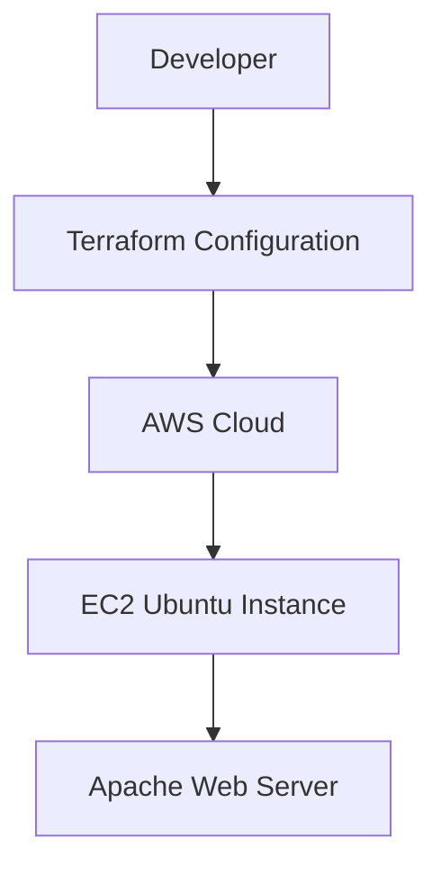
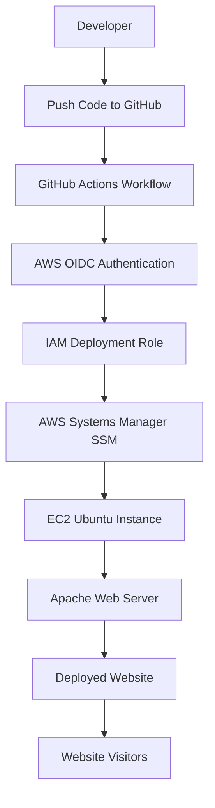

# Automated Deployment of a Web Application on AWS EC2 Using Terraform

## Project Overview

This project demonstrates the automated deployment of a web application on AWS EC2 using Terraform and GitHub Actions.

The main objective is to automate cloud infrastructure provisioning and website deployment using DevOps tools.

## Technologies Used

- **AWS:** Cloud platform
- **Terraform:** Infrastructure as Code (IaC)
- **Amazon EC2:** Virtual server
- **Ubuntu:** Operating system
- **Apache:** Web server
- **Git & GitHub:** Version control and source code management
- **GitHub Actions:** CI/CD automation
- **AWS Systems Manager (SSM):** Remote command execution
- **HTML & CSS:** Website development

## Project Architecture


## Project Architecture

The project consists of two main processes:

### 1. Infrastructure Provisioning



### 2. Automated Website Deployment




## Project Features

- Automated infrastructure provisioning.
- Automated website deployment.
- GitHub Actions CI/CD pipeline.
- Secure AWS authentication using OIDC.
- Remote deployment using AWS Systems Manager.
- Backup of the previous website version.

## Repository Structure

```text
DevOpsProject/
│
├── .github/
│   └── workflows/
│       └── deploy.yml
│
├── .gitignore
├── .terraform.lock.hcl
├── index.html
├── main.tf
├── provider.tf
├── security.tf
└── README.md
```

## Deployment Process

1. Create and configure AWS infrastructure using Terraform.
2. Launch an Ubuntu EC2 instance.
3. Install and configure Apache.
4. Push project files to GitHub.
5. GitHub Actions automatically runs the deployment workflow.
6. AWS SSM deploys the website to EC2.
7. The updated website becomes available through the EC2 public IP.

## Project Outcome

Successfully implemented an automated website deployment workflow using Terraform, AWS EC2, GitHub Actions, and AWS Systems Manager.

## Author

MCA Student

## Project Title

Automated Deployment of a Web Application on AWS EC2 Using Terraform
