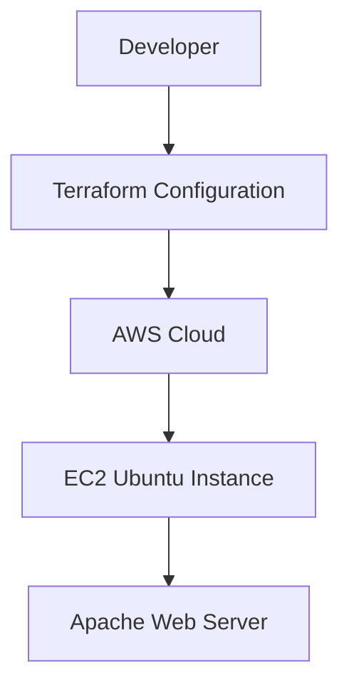
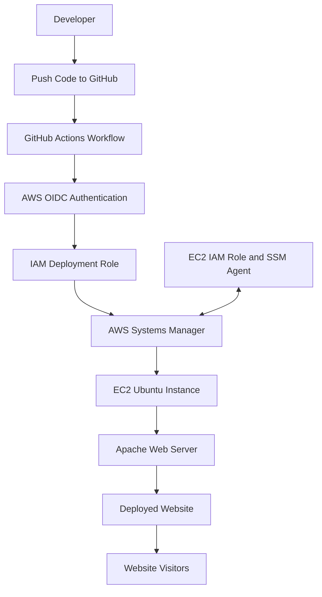

# Automated Deployment of a Web Application on AWS EC2 Using Terraform

## 1. Project Overview

This project demonstrates the automated deployment of a web application on AWS EC2 using Terraform and GitHub Actions.

The main objective is to automate cloud infrastructure provisioning and website deployment using DevOps tools and CI/CD practices.

## 2. Technologies Used

- **AWS:** Cloud platform
- **Terraform:** Infrastructure as Code (IaC)
- **Amazon EC2:** Virtual server
- **Ubuntu:** Operating system
- **Apache:** Web server
- **Git & GitHub:** Version control and source code management
- **GitHub Actions:** CI/CD automation
- **AWS Systems Manager (SSM):** Remote command execution
- **AWS IAM and OIDC:** Secure authentication and access management
- **HTML & CSS:** Website development

## 3. Prerequisites

- AWS account
- Terraform installed
- Git installed
- GitHub account and repository
- Required AWS IAM permissions
- Basic knowledge of AWS and Terraform

## 4. Project Architecture

The project consists of two main processes.

### 4.1 Infrastructure Provisioning



### 4.2 Automated Website Deployment



## 5. Project Features

- Automated infrastructure provisioning using Terraform.
- Automated website deployment using GitHub Actions.
- CI/CD pipeline triggered by GitHub code changes.
- Secure AWS authentication using OIDC.
- Remote deployment using AWS Systems Manager.
- Automatic backup of the previous website version.
- Website hosting using Apache on Ubuntu EC2.

## 6. Repository Structure

```text
DevOpsProject/
|
|-- .github/
|   |-- workflows/
|       |-- deploy.yml
|
|-- .gitignore
|-- .terraform.lock.hcl
|-- index.html
|-- main.tf
|-- provider.tf
|-- security.tf
|-- README.md
```

## 7. Deployment Process

1. Configure AWS provider and infrastructure using Terraform.
2. Create an EC2 Ubuntu instance and security group.
3. Install and configure Apache web server.
4. Push project source code to GitHub.
5. GitHub Actions automatically triggers the deployment workflow.
6. GitHub authenticates with AWS using OIDC.
7. AWS Systems Manager sends deployment commands to EC2.
8. The previous website version is backed up.
9. The latest website file is deployed to Apache.
10. The updated website becomes accessible through the EC2 public IP address.

## 8. Project Outcome

Successfully implemented and tested an automated website deployment workflow using Terraform, AWS EC2, GitHub Actions, AWS IAM OIDC authentication, and AWS Systems Manager.

The project demonstrates Infrastructure as Code, cloud infrastructure management, CI/CD automation, and automated web application deployment.

## 9. Author

MCA Student

## 10. Project Title

Automated Deployment of a Web Application on AWS EC2 Using Terraform
Documentation updated